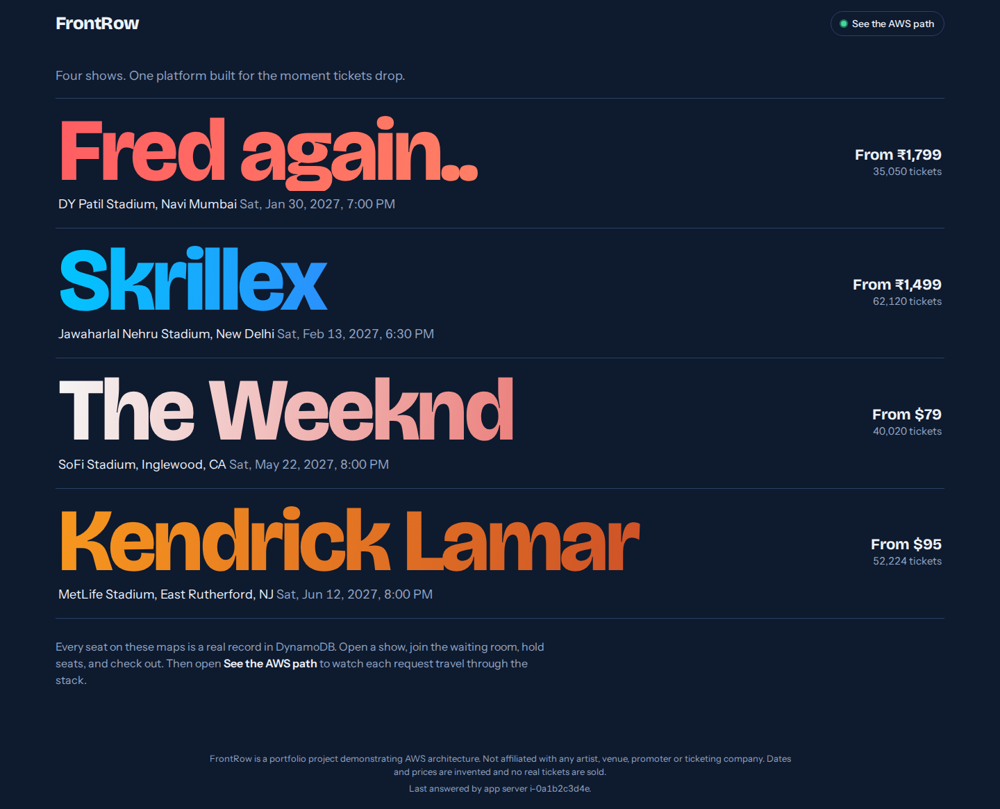
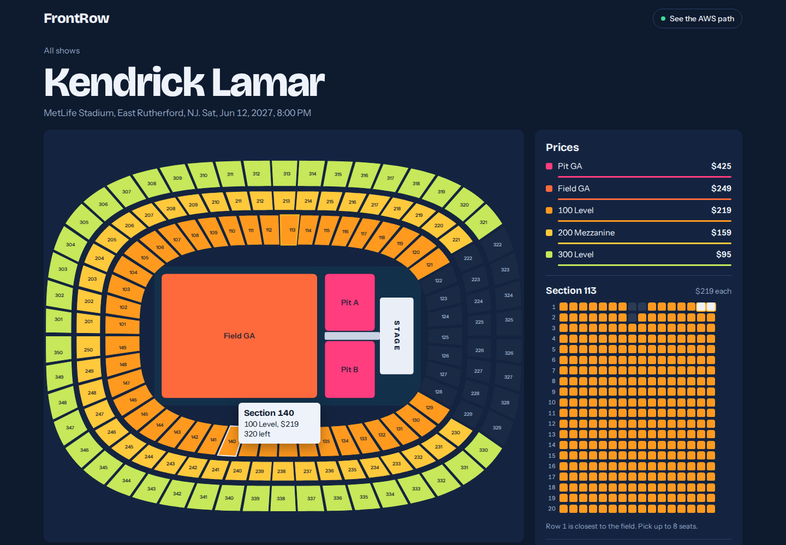
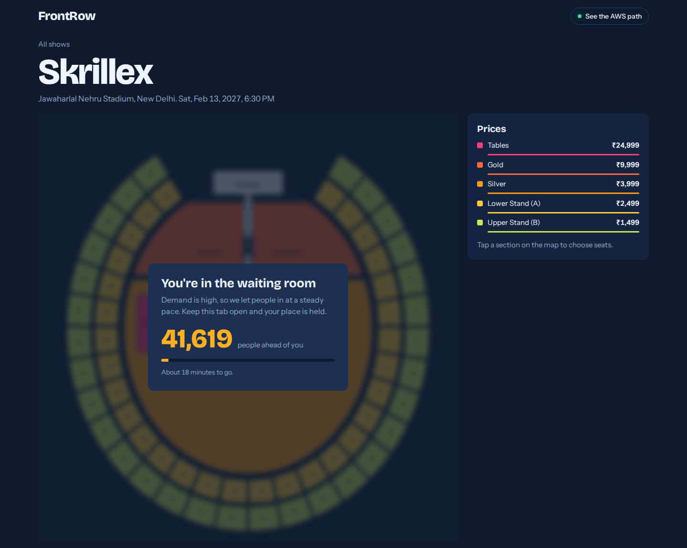
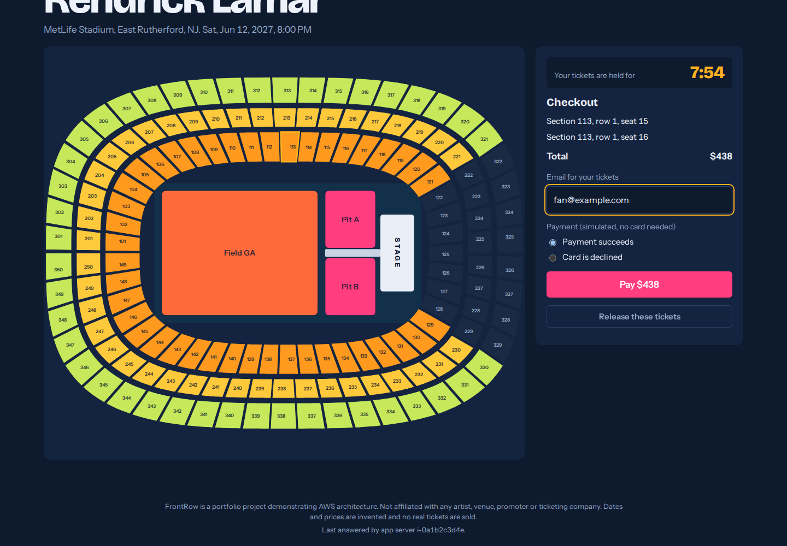
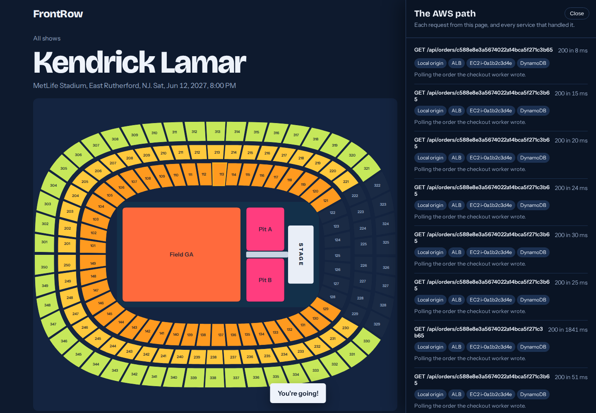
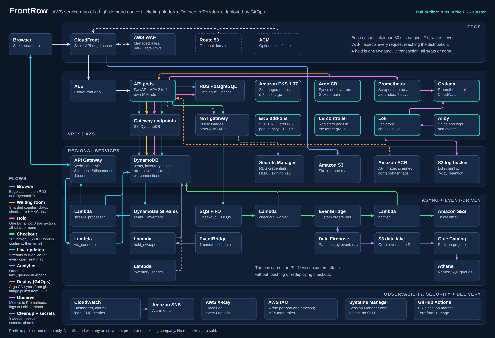
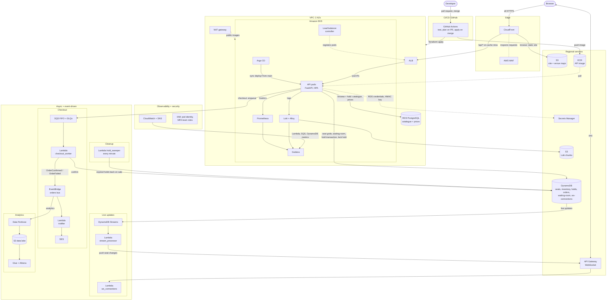

# FrontRow

FrontRow is a concert ticketing platform on AWS, built for the moment tickets drop: a huge crowd arrives at once and everyone wants the same seats. It sells 113,964 individually numbered seats and 75,450 general-admission places across four stadium shows, and it is designed so that no seat can be sold twice. A DynamoDB transaction decides every hold in one atomic step. A waiting room admits buyers at a rate the back end can absorb, CloudFront absorbs browsing traffic, and checkout runs through a queue so a payment outage cannot take the shop down. The API runs on Amazon EKS behind CloudFront and an ALB, with serverless Lambdas for everything event-driven. Git is the source of truth: GitHub Actions applies Terraform and ships the image, Argo CD syncs the cluster, and Prometheus, Grafana and Loki watch it. Every pod and person gets least-privilege IAM. There are 19 automated tests and a script that races buyers for one seat on the deployed system.



| Pick seats on a live map | Wait your turn in the queue |
|---|---|
|  |  |

| Check out inside an 8-minute hold | See the AWS path behind each request |
|---|---|
|  |  |

*Screenshots were captured from a local run, so the drawer says "Local origin" and its timings are not AWS numbers. On the deployed stack it also shows the CloudFront location, cache hits and WAF.*

## Service map



An interactive version is in [docs/service-map.html](docs/service-map.html): download it, open it in a browser and click a flow to isolate it.



Grafana puts the pods (Prometheus), their logs (Loki) and the serverless side (CloudWatch) on one screen. CloudWatch alarms still page through SNS, and every Lambda is traced in X-Ray.

## Tech stack

| Layer | What it uses |
|---|---|
| Front end | Plain HTML, CSS and JavaScript with SVG seat maps; no framework or build step |
| API | Python 3.12, FastAPI, Uvicorn, SQLAlchemy, boto3, in a non-root container image |
| Data | DynamoDB (seats, holds, waiting room) and RDS PostgreSQL 16 (orders) |
| Async | SQS FIFO, Lambda (Python 3.12), EventBridge, SES, DynamoDB Streams, API Gateway WebSocket, Kinesis Data Firehose |
| Edge | CloudFront, AWS WAF, Route 53, ACM, Application Load Balancer |
| Compute | Amazon EKS 1.37 on managed nodes, with the AWS Load Balancer Controller and EKS Pod Identity |
| Network | VPC across two AZs, one NAT gateway, S3 and DynamoDB gateway endpoints |
| Delivery | Terraform, GitHub Actions with OIDC to AWS, Amazon ECR, Argo CD, Helm |
| Observability | Prometheus, Grafana, Loki and Alloy, plus CloudWatch, X-Ray and SNS alarms |
| Security | IAM roles per pod and per team role with MFA, Secrets Manager, encryption at rest on every data store |
| Testing | pytest with moto, kubeconform, actionlint, and load and race scripts |

## The shows

| Artist | Venue | Date | Sections | Numbered seats | GA places | Tickets | Prices |
|---|---|---|---:|---:|---:|---:|---|
| Fred again.. | DY Patil Stadium, Navi Mumbai | 30 Jan 2027 | 33 | 9,600 | 25,450 | 35,050 | ₹1,799 to ₹29,999 |
| Skrillex | Jawaharlal Nehru Stadium, New Delhi | 13 Feb 2027 | 64 | 27,720 | 34,400 | 62,120 | ₹1,499 to ₹24,999 |
| The Weeknd | SoFi Stadium, Inglewood, CA | 22 May 2027 | 215 | 40,020 | 0 | 40,020 | $79 to $399 |
| Kendrick Lamar | MetLife Stadium, East Rutherford, NJ | 12 Jun 2027 | 152 | 36,624 | 15,600 | 52,224 | $95 to $425 |

Shows, dates and prices are invented, and the seat maps are original drawings that approximate each venue.

## Key design decisions

The full reasoning, capacity math, failure modes and security model are in [docs/ARCHITECTURE.md](docs/ARCHITECTURE.md).

- **The hold is the correctness boundary.** Clicking *Hold* runs one `TransactWriteItems`: every seat or none, and two buyers racing for a seat find out within milliseconds, before anyone starts paying. ([ADR-3](docs/ARCHITECTURE.md#adr-3-the-hold-is-the-correctness-boundary))
- **Seats live in DynamoDB, the catalogue in RDS.** Seat writes are huge in number and always by exact key, while the catalogue is small and relational. ([ADR-1](docs/ARCHITECTURE.md#adr-1-seats-are-dynamodb-items-rds-keeps-the-catalogue))
- **Seats are partitioned by event and section.** An on-sale spreads across 33 to 215 partition keys per show instead of one hot key. ([ADR-2](docs/ARCHITECTURE.md#adr-2-partition-seats-by-event-and-section))
- **Checkout goes through SQS FIFO.** The API answers `202` immediately, a Lambda worker pays and confirms, and a conditional write makes redelivered messages harmless. ([ADR-4](docs/ARCHITECTURE.md#adr-4-sqs-fifo-for-checkout-grouped-by-hold))
- **GA zones use sharded counters.** A 15,000-capacity field is split into 8 items, so buyers don't all contend on one. ([ADR-5](docs/ARCHITECTURE.md#adr-5-ga-zones-use-sharded-counters))
- **The live map is derived from DynamoDB Streams.** Counters are eventually consistent and display-only, which keeps the hold path short. The hold condition stays the authority. ([ADR-6](docs/ARCHITECTURE.md#adr-6-live-seat-map--streams--websocket-counters-are-derived))
- **The waiting room is arithmetic, not a worker.** Admission is computed from a rate and a clock, and passes are HMAC-signed, so checking your place costs no database write. ([ADR-7](docs/ARCHITECTURE.md#adr-7-the-waiting-room-is-arithmetic-not-a-worker))
- **The edge is the first scaling tier.** A 2-second cache turns a million identical availability requests into about one origin request per CloudFront location every 2 seconds. ([ADR-8](docs/ARCHITECTURE.md#adr-8-the-edge-is-the-first-scaling-tier))
- **EventBridge decouples everything after the sale.** Email and analytics subscribe to order events, and no personal data goes on the bus. ([ADR-9](docs/ARCHITECTURE.md#adr-9-eventbridge-decouples-everything-after-the-sale))
- **The API runs on EKS; event-driven work stays on Lambda.** Pods join the existing ALB target group through a `TargetGroupBinding`, so CloudFront, WAF and the ALB didn't change. ([ADR-10](docs/ARCHITECTURE.md#adr-10-eks-for-the-api-lambda-for-event-driven-work))
- **Two GitOps loops.** GitHub Actions applies Terraform for AWS; Argo CD syncs `deploy/` into the cluster and reverts manual changes. ([ADR-12](docs/ARCHITECTURE.md#adr-12-git-is-the-source-of-truth-gitops), [ADR-14](docs/ARCHITECTURE.md#adr-14-two-gitops-loops-terraform-for-aws-argo-cd-for-the-cluster))
- **Prometheus, Grafana and Loki in the cluster, CloudWatch for serverless.** The API alerts on the 300 ms hold target from the requirements. ([ADR-15](docs/ARCHITECTURE.md#adr-15-observability-prometheus-grafana-and-loki-in-the-cluster-cloudwatch-for-serverless))
- **IAM for pods and people.** Each pod has its own role through EKS Pod Identity; people assume MFA-protected team roles that also grant their cluster access. ([ADR-16](docs/ARCHITECTURE.md#adr-16-iam-for-people-and-pods))
- **One NAT gateway, for public images.** S3 and DynamoDB keep free gateway endpoints, and the database subnets have no internet route. ([ADR-13](docs/ARCHITECTURE.md#adr-13-one-nat-gateway-for-the-cluster))

The document ends with [what would change at Ticketmaster or BookMyShow scale](docs/ARCHITECTURE.md#8-what-changes-at-ticketmaster-or-bookmyshow-scale).

## Deploy

FrontRow is deployed with GitOps: the `main` branch is the source of truth. GitHub Actions makes AWS match it with Terraform and pushes the API image to ECR; Argo CD makes the cluster match `deploy/`. You set the pipeline up once. After that, every change goes through a pull request, and nothing is applied from a laptop.

| Workflow | When it runs | What it does |
|---|---|---|
| [Pull request](.github/workflows/pull-request.yml) | Every pull request to `main` | Runs the tests, builds the image, validates every Kubernetes manifest, then posts the Terraform plans on the pull request |
| [Deploy](.github/workflows/deploy.yml) | Every merge to `main` | Applies shared resources, pushes the API image if it changed, applies the stack; Argo CD rolls out the cluster |
| [Drift check](.github/workflows/drift.yml) | Daily | Compares AWS with `main` and opens an issue if someone changed AWS by hand |
| [Destroy](.github/workflows/destroy.yml) | Manually | Removes what Argo CD deployed, then deletes the stack, after you type `destroy frontrow` |

The workflows get short-lived AWS credentials over OIDC, so no access keys are stored in GitHub. Builds are reproducible and the image tag is a hash of its inputs, so a merge only redeploys the Lambdas or the API when their code actually changed.

**Set it up once.** You need Terraform 1.10 or later, AWS admin credentials and a GitHub repository.

1. **Create the state bucket and GitHub roles.** This is the only step run from your machine:

   ```bash
   cd terraform/bootstrap
   terraform init
   terraform apply -var github_repository=<owner>/<repo>
   ```

   If your AWS account already trusts GitHub Actions over OIDC, add `-var create_oidc_provider=false`. Keep the local `terraform.tfstate` this creates.

2. **Configure the GitHub repository** under *Settings*:
   - **Variables** (*Secrets and variables > Actions > Variables*): the four values printed as `github_variables`, plus `SENDER_EMAIL` (the address SES sends tickets from) and, optionally, `ALERT_EMAIL` for CloudWatch alarms.
   - **Environment** named `production`. Under *Deployment branches*, allow only `main`; this is required, because the deploy role trusts this environment. Add yourself as a required reviewer if you want to approve each deploy.
   - **Branch protection** on `main`: require a pull request and the *Test* check to pass.
   - **Repository visibility:** Argo CD reads `deploy/` from this repository. A public repository needs nothing more. For a private one, add read-only credentials to Argo CD once (a GitHub deploy key, with `argocd repo add`), because Argo CD can't use the pipeline's token.

3. **Add your team** (optional) in [terraform/environments/shared.tfvars](terraform/environments/shared.tfvars): each person's IAM user name and group (`admins`, `developers` or `readonly`).

4. **Push to `main`.** The Deploy workflow creates the shared resources, the image, EKS and the rest of the stack, and seeds every seat into DynamoDB. Argo CD then installs the observability stack and the API, which takes a few more minutes. The site URL is in the run summary.

5. **Verify the SES sender.** SES emails a verification link to `SENDER_EMAIL` during the first deploy, so click it. If your account is still in the SES sandbox, recipient addresses must be verified too. The simplest option is to buy tickets using the sender address.

**Change anything** in a pull request: code, Terraform, settings such as node sizes and WAF limits in [terraform/environments/prod.tfvars](terraform/environments/prod.tfvars), or anything Argo CD runs in [deploy/](deploy/), including chart versions. Merging applies it.

**Shut it down when you're done,** because it costs money while it runs: run *Actions > Destroy*. Re-run *Deploy* to bring it back. ECR images, team IAM, the state bucket and the GitHub roles stay; they cost a few cents a month.

## Operate the cluster

Grafana and Argo CD have no public endpoint. Assume your team role (with MFA), then:

```bash
aws eks update-kubeconfig --region us-east-1 --name frontrow

# Grafana: dashboards for the API, the cluster and CloudWatch, plus Loki logs
kubectl -n monitoring port-forward svc/kube-prometheus-stack-grafana 3000:80
kubectl -n monitoring get secret grafana-admin -o jsonpath='{.data.admin-password}' | base64 -d

# Argo CD: what is synced from main, and what is drifting
kubectl -n argocd port-forward svc/argocd-server 8080:80
kubectl -n argocd get secret argocd-initial-admin-secret -o jsonpath='{.data.password}' | base64 -d
```

Open the *FrontRow API* dashboard for request rate, errors, p95 latency by route, hold outcomes and API logs. In *Explore*, query Loki with `{namespace="frontrow"}`. Developers can edit the `frontrow` namespace and view the rest; read-only users can view everything except Secrets.

## Demo

All commands run from the repo root. Start by setting the URL from the Deploy run's summary:

```bash
export URL=https://<your-distribution>.cloudfront.net
```

These scripts change data (seats, holds, the waiting room), not infrastructure, so they don't count as drift.

**1. Prove a seat can't be sold twice.** 100 buyers go through the waiting room and try to hold the same seat at the same instant. Exactly one should win. The test prints `PASS` or `FAIL`, plus how the requests spread across app servers.

```bash
python3 scripts/race_test.py --url "$URL" --event kendrick-lamar-metlife-2027 --section 113 --seat "R10#S07" --buyers 100
```

The winning hold lasts 8 minutes, so pass a different `--seat` to repeat the test sooner. Add `--email you@example.com` to check out the winner and send the ticket to an SES-verified address.

**2. Start an on-sale.** The gate opens in 60 seconds, admits 50 people, then 20 per second. Open the show in a browser to join the queue. This script needs `pip install boto3` and your AWS credentials.

```bash
python3 scripts/onsale.py --event skrillex-delhi-2027 --opens-in 60 --rate 20 --initial 50
```

Use `--open` to turn the waiting room off again. If you deployed outside `us-east-1`, add `--region`.

**3. Send a stampede of browsing traffic.** Watch the edge cache absorb reads, the ALB spread the rest, and the HorizontalPodAutoscaler add API pods (`kubectl -n frontrow get hpa -w`, or the Grafana dashboard). Add `--bust-cache` to push the load through to the pods and DynamoDB.

```bash
python3 scripts/load_test.py --url "$URL" --workers 200 --minutes 10
```

From a single machine you'll hit the WAF rate limit, which is that limit doing its job. For a pure scaling test, raise `waf_api_rate_limit` in `terraform/environments/prod.tfvars` in a pull request and merge it.

**4. Open the "See the AWS path" drawer.** It's the button at the top right of the site. Hold seats and check out with it open, and it lists each request from the page, the services that handled it (down to the EKS pod), and why. Refresh a show to see cached responses answered at the edge.

**Afterwards:** `terraform output` prints links (run `terraform init -backend-config="bucket=<TF_STATE_BUCKET>" -backend-config="region=<TF_STATE_REGION>"` in `terraform/` first; reading outputs is fine, applying from your machine is not) to the CloudWatch dashboard, the X-Ray service map and Athena, where the `frontrow-analytics` workgroup has saved queries for revenue by show, sales per minute and checkout failures. To put a show back on sale when no holds are active, run `python3 scripts/reset_event.py --event <event-id>`.

## Tests

```bash
pip install -r requirements-dev.txt
pytest -q
```

All 19 tests run locally against mocked AWS services, so they need no account. They cover the race for a single seat, all-or-nothing multi-seat holds, GA overselling, hold expiry, the full checkout flow and the Prometheus metrics. SQLite stands in for RDS, so they don't need Postgres or `psycopg2`. The pull request and deploy workflows run them on every change, and also build and smoke-test the API image, render and schema-check every Kubernetes manifest (`scripts/check-deploy.sh`), check that the Lambda build is reproducible, and check that Terraform is formatted and valid.

## Cost

Running the stack costs about **$9 to $10 per day** on demand in `us-east-1` with idle-to-light demo traffic. Most of that is the two EKS nodes, the EKS control plane, the NAT gateway, the ALB and RDS. See the [cost breakdown](docs/ARCHITECTURE.md#7-cost), then deploy, demo and destroy.

## Disclaimer

FrontRow is a portfolio project and demo only. It is not affiliated with, endorsed by, or connected to any artist, venue, promoter or ticketing company. Dates and prices are invented, payment is simulated, and no real tickets are sold.
